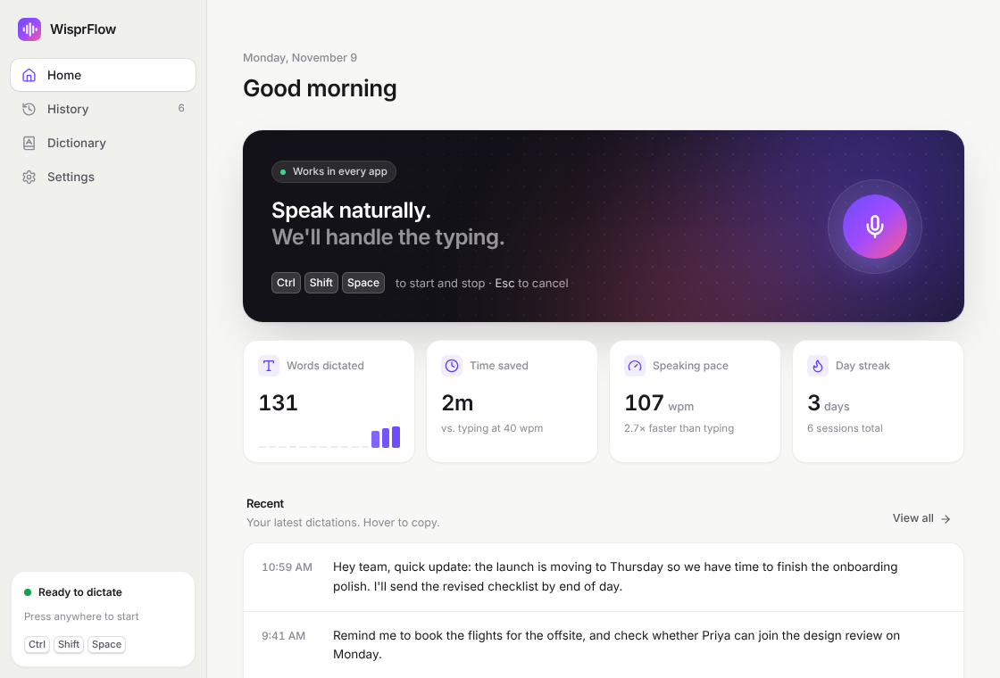
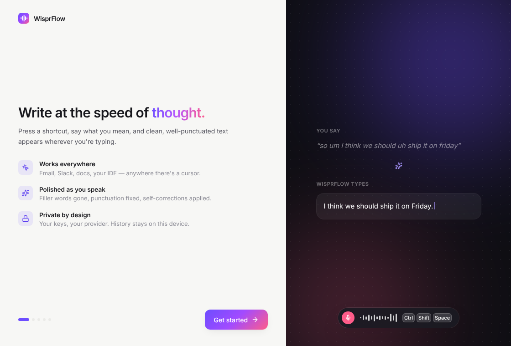
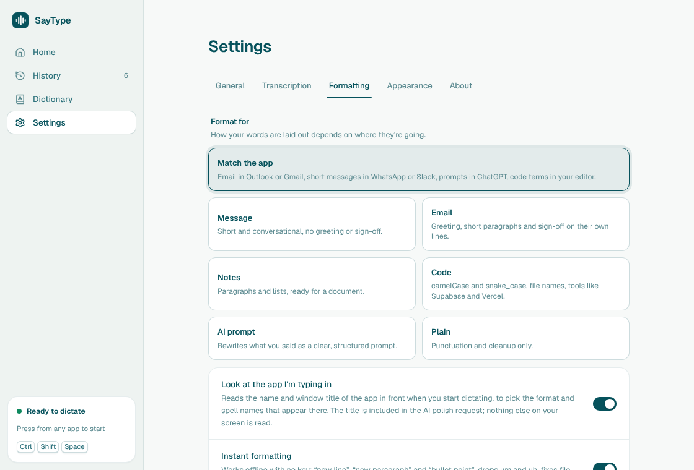
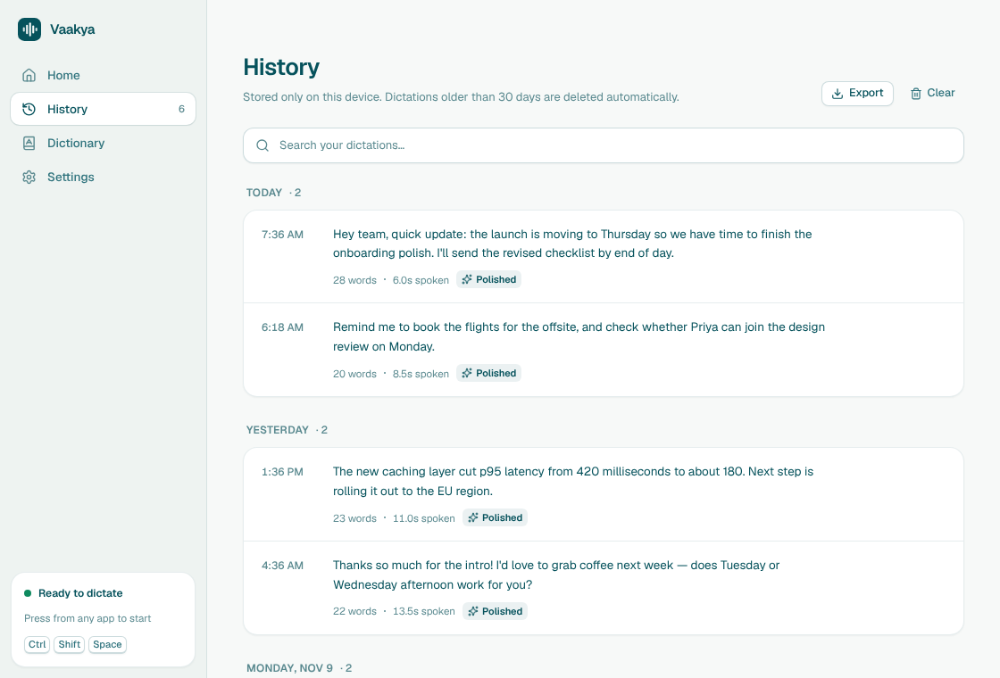
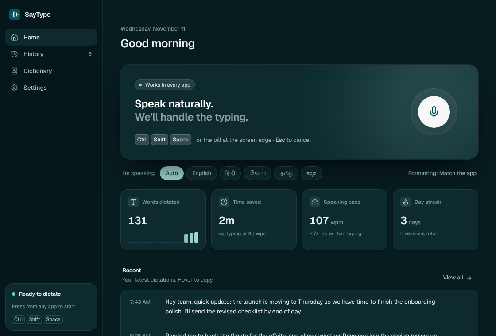
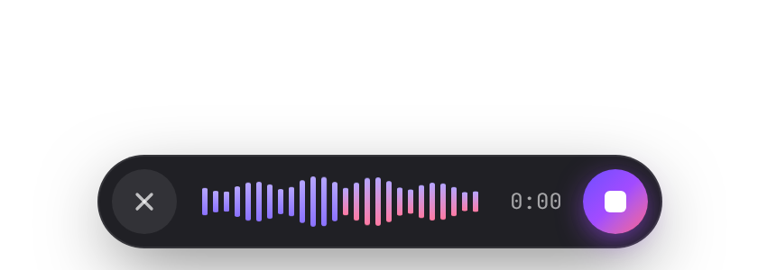
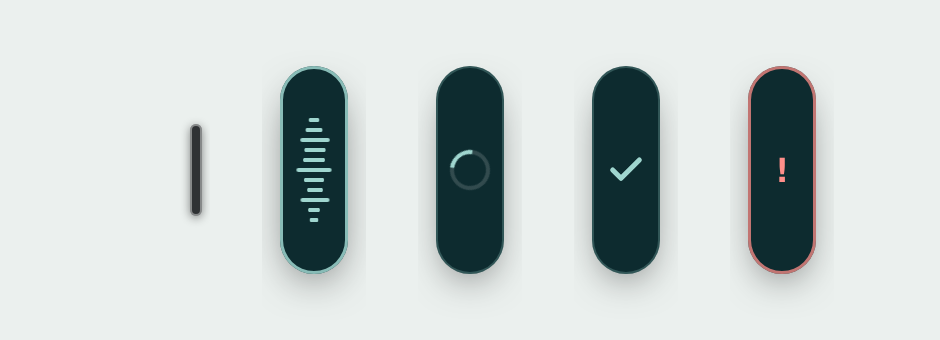

<p align="center"></p>
<h1 align="center">WisprFlow</h1>
<p align="center">Privacy-first voice dictation for your desktop.<br/>Press a shortcut, speak, and clean, well-punctuated text appears wherever your cursor is.</p>

<p align="center"></p>

<p align="center"><a href="https://github.com/santhankrishna8/wisprflow/releases/latest/download/WisprFlow-Setup.exe"><b>⬇ Download for Windows</b></a></p>

## Features

- **Dictate anywhere** – a global shortcut (default <kbd>Ctrl/⌘</kbd> <kbd>Shift</kbd> <kbd>Space</kbd>) starts recording; press again to transcribe and paste at your cursor. <kbd>Esc</kbd> cancels.
- **Floating button** – a small always-on-top button on the edge of your screen. Click it to start/stop listening, drag it anywhere (it snaps to the nearest edge and remembers its spot), hover and press × to hide it. Toggle it in Settings → General or from the tray menu.
- **Floating recording pill** – a live waveform, timer, and cancel/finish buttons that never steal focus from the app you're typing in.
- **AI polish** – removes filler words, fixes punctuation, applies spoken self-corrections ("4, actually 5" → "5") and formats lists. Choose a style: Natural, Professional, Casual or Verbatim.
- **Free, private, offline transcription** – choose **On this PC** and WisprFlow runs Whisper (whisper.cpp) on your own computer. No API key, no Docker, no cost. Pick a model (Tiny 75 MB → Large v3 Turbo 574 MB) and it downloads once. The engine only runs while you dictate and shuts itself down after 10 idle minutes.
- **Or bring your own provider** – OpenAI (Whisper / GPT-4o transcribe) or Groq (Whisper Large v3) for speech-to-text, and OpenAI, Anthropic Claude, or Groq for cleanup. Any **OpenAI-compatible self-hosted server** (Speaches, faster-whisper-server, Ollama, LM Studio) works too, so you can run fully offline.
- **Personal dictionary** – names, jargon and replacements, used as transcription hints and enforced during cleanup.
- **History & stats** – searchable history grouped by day, with the original transcript next to the polished one, plus words dictated, time saved, speaking pace and streak.
- **Thoughtful details** – onboarding, light/dark/system themes, clipboard restore, sound cues, a tray menu, launch at login, and a microphone picker.
- **Private** – history, dictionary and settings live in a local file; API keys are encrypted with the OS keychain (Electron `safeStorage`); no telemetry.

| Onboarding | Settings |
| --- | --- |
|  |  |
| **History** | **Dark mode** |
|  |  |

<p align="center"></p>
<p align="center"></p>

## Getting started

Requires Node.js 20+.

```bash
npm install
```

```bash
npm run dev
```

`npm run dev` starts Vite and Electron together with hot reload. To work on the UI in a normal browser with a mocked backend, run `npm run dev:web` and open <http://localhost:5173> (`?onboarding`, `?theme=dark`, `?empty` and `?route=settings` are handy query flags; `overlay.html?demo=recording` previews the pill).

### Build installers

```bash
npm run dist
```

Use `dist:mac`, `dist:win` or `dist:linux` to build for one platform. Output goes to `release/`.

You can also build the Windows installer on GitHub: open **Actions → Build Windows installer → Run workflow**, then download `WisprFlow-Windows-installer` from the finished run.

## On-device transcription

The installers bundle a CPU build of `whisper-server` (whisper.cpp, pinned and SHA-256 verified by `scripts/fetch-whisper.cjs`). Models download from Hugging Face into WisprFlow's data folder the first time you choose them. When you start recording, WisprFlow starts the engine so the model loads while you speak; it reuses it for back-to-back dictations and stops it after 10 minutes of inactivity or when you quit.

For AI cleanup without the cloud, install [Ollama](https://ollama.com), run `ollama pull llama3.2:3b`, then pick **Self-hosted → Use Ollama** under Settings → AI cleanup. If cleanup isn't configured, WisprFlow pastes the raw transcript.

The Windows CI build smoke-tests this end to end: it downloads the Tiny model and transcribes a speech sample with the packaged engine.

## Platform notes

- **macOS** – grant Microphone and Accessibility access (onboarding walks you through it). Accessibility is needed to paste into other apps.
- **Windows** – works out of the box.
- **Linux** – auto-paste uses `xdotool` on X11, and `wtype` or `ydotool` on Wayland. Install one of them; otherwise the text is left on your clipboard. Some Wayland compositors restrict global shortcuts.

## How it works

```
electron/
  main.cjs      windows, global shortcut, tray, dictation pipeline, IPC
  preload.cjs   the typed `window.wispr` bridge
  ai.cjs        speech-to-text + LLM cleanup (OpenAI-compatible & Anthropic)
  localWhisper.cjs  on-device engine: model downloads, on-demand whisper-server, idle shutdown
  paste.cjs     clipboard + simulated paste per platform
  store.cjs     JSON persistence with keychain-encrypted API keys
src/
  App.tsx       shell and sidebar
  pages/        Home, History, Dictionary, Settings, Onboarding
  overlay/      recording pill, mic capture and level metering
  bubble/       always-on-top floating dictation button
  components/   UI kit (buttons, switches, hotkey recorder, toasts…)
```

The shortcut shows the overlay, which records audio with `MediaRecorder`. On the second press the audio goes to the main process, which transcribes it, applies your dictionary, optionally polishes it with an LLM, pastes it, and saves it to history. API keys never reach the renderer.

## Releasing & website

- **Release:** push a tag such as `v0.2.0`. GitHub Actions builds the installer, runs the on-device transcription smoke test, and publishes `WisprFlow-Setup.exe` to GitHub Releases. The permanent download link is `https://github.com/santhankrishna8/wisprflow/releases/latest/download/WisprFlow-Setup.exe`.
- **Website:** the landing page lives in `site/` (plain HTML, no build). On Vercel, import the repo and set **Root Directory** to `site` with the **Other** framework preset.

## Scripts

| Script | Purpose |
| --- | --- |
| `npm run dev` | Electron + Vite with hot reload |
| `npm run dev:web` | UI only, in the browser, with a mock backend |
| `npm run typecheck` | TypeScript check |
| `npm test` | Unit tests for the text pipeline |
| `npm run dist` | Package installers with electron-builder |

## Credits

Inspired by [OpenWhispr](https://github.com/OpenWhispr/openwhispr) (MIT). MIT licensed.
